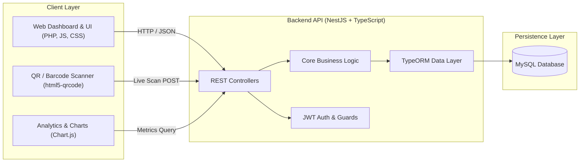

# Nventory — Warehouse & Inventory Management System

<p align="center">
  
</p>

<p align="center">
  <strong>A full-stack, modular inventory and warehouse management platform featuring real-time stock auditing, camera-based QR code scanning, and automated sales velocity & stockout forecasting.</strong>
</p>

<p align="center">
  
  
  
  
  
  
  
</p>

---

## 📌 Executive Summary & What Was Built

**Nventory** was developed as an end-to-end warehouse logistics and inventory tracking solution designed to replace manual stock spreadsheets with an automated, auditable system. 

### Key Accomplishments & Deliverables
- **Decoupled Modern Architecture**: Built a high-performance **NestJS (TypeScript)** RESTful backend paired with a dynamic, responsive frontend (PHP/JS/CSS).
- **Physical-to-Digital Sync via QR Scanning**: Implemented an in-browser barcode/QR code scanner (`html5-qrcode`) that enables warehouse personnel to scan item labels via mobile or webcam to instantly book goods in (`in`) or out (`out`).
- **Live Inventory & Threshold Alerts**: Designed real-time inventory tracking with automated low-stock warnings when quantities drop below a configurable safety threshold.
- **Auditable Transaction Ledger**: Implemented an immutable transaction event log (`articleTransactions`) capturing every inventory movement, timestamp, unit price, and volume change.
- **Business Intelligence & Runout Forecasting**: Developed sales analytics calculating product profit margins (Deckungsbeitrag / DB), revenue volume, 7-day sales trends, and **stock coverage analysis** (estimating days of inventory remaining based on historical run rate to prevent stockouts).
- **Enterprise Security**: Implemented JWT-based API authentication, password hashing with Bcrypt, and DTO validation.

---

## 🏗️ Architecture & Data Flow



---

## 🚀 Core Features

### 1. Operations & Stock Management
- **Catalog Management**: Full CRUD capabilities for articles, shelves, and warehouse facilities.
- **Search & Multi-Column Sorting**: Instant client-side search and server-side multi-parameter sorting (by SKU, stock volume, price, name).
- **Stock Rebalancing**: Fast stock adjustments with automatic transaction validation (prevents negative inventory).

### 2. QR Code Scanning & Mobile Workflow
- Integrated camera-based scanner directly inside the web browser.
- Instant article lookup upon scan with live metadata presentation.
- Quick single-click Inbound / Outbound booking with dynamic cost override.

### 3. Executive Dashboard & Predictive Analytics
- **Live KPI Cards**: Total active SKUs, total units on hand, total inventory valuation (EUR), and critical stock counts.
- **Sales Trend Graph**: 7-day rolling sales volume visualization powered by Chart.js.
- **Nutzwertanalyse (Runout Forecasting)**: Automatically calculates average daily burn rate:
  $$\text{Days Remaining} = \frac{\text{Current Stock Quantity}}{\varnothing \text{ Daily Sales}}$$
  Identifies supply chain bottlenecks before items run out.
- **Profitability Metrics**: Tracks unit acquisition costs vs. sales prices to calculate realized margin (Deckungsbeitrag) and gross revenue per SKU.

---

## 🛠️ Tech Stack

| Domain | Technology | Purpose |
| :--- | :--- | :--- |
| **Backend Framework** | [NestJS](https://nestjs.com/) (v11) | Enterprise TypeScript Node.js backend |
| **Language** | TypeScript / Node.js (v18+) | Strongly typed server-side logic |
| **ORM** | [TypeORM](https://typeorm.io/) | Object-Relational Mapping & query builder |
| **Database** | MySQL / MariaDB | Relational database storage |
| **Frontend** | PHP 8.2, JavaScript (ES6+), HTML5, CSS3 | Server-rendered templates & dynamic UI |
| **Visualization** | [Chart.js](https://www.chartjs.org/) | Interactive metrics and time-series charts |
| **Hardware Integration** | [html5-qrcode](https://github.com/mebjas/html5-qrcode) | Camera barcode/QR scanning engine |
| **Security** | Passport, JWT, Bcrypt | Token authentication & password hashing |

---

## 📂 Repository Structure

```text
├── DATABASE/
│   └── nventory_dump.sql        # Database schema and seed fixtures
├── CSS/                         # Modular component stylesheets
├── HTML/                        # Reusable view components (header, footer, nav)
├── JAVASCRIPT/                  # Client-side controllers & scanner integration
│   ├── scanProduct.js           # QR scanner logic & stock booking
│   ├── personalDashboard.js     # Dashboard state & KPI handling
│   ├── statistik.js             # Financial & margin calculation scripts
│   └── productStock.js          # Table sorting, filtering, and search
├── api/                         # Frontend authentication bridge endpoints
├── includes/                    # Shared PHP includes & session helpers
├── pictures/                    # UI branding, logos, and iconography
├── nventory-backend/            # NestJS TypeScript REST API
│   ├── src/
│   │   ├── core/                # Domain services (Article, Transaction, Shelf, User)
│   │   ├── entities/            # TypeORM entities (Article, Shelf, Warehouse, etc.)
│   │   ├── http/                # REST API controllers & DTOs
│   │   ├── app.module.ts        # Main application module
│   │   └── main.ts              # Server bootstrap entry point
│   └── package.json             # Backend dependencies & scripts
├── analysis.php                 # Runout & stock coverage analysis view
├── personalDashboard.php        # Primary operational dashboard
├── productStock.php             # Inventory table & catalogue overview
├── scanProduct.php              # Camera-based scanner interface
├── transactions.php             # Audit log view for stock movements
└── package.json                 # Root project manifest
```

---

## ⚙️ Getting Started

### Prerequisites
- **Node.js** (v18.x or later) & **npm**
- **PHP** (8.2+ recommended) & **Apache** (e.g., via [XAMPP](https://www.apachefriends.org/))
- **MySQL / MariaDB** (10.4+)

---

### Step 1: Database Setup
1. Start MySQL via XAMPP or your native service.
2. Open **phpMyAdmin** (or your SQL client of choice) and create a database named `nventory`.
3. Import the initial schema and seed data:
   ```sh
   mysql -u root -p nventory < DATABASE/nventory_dump.sql
   ```

---

### Step 2: Backend Configuration & Launch
1. Navigate to the backend directory:
   ```sh
   cd nventory-backend
   ```
2. Install dependencies:
   ```sh
   npm install
   ```
3. Configure environment variables in `nventory-backend/.env`:
   ```env
   DB_HOST=localhost
   DB_PORT=3306
   DB_USER=root
   DB_PASS=
   DB_NAME=nventory
   ```
4. Start the NestJS development server:
   ```sh
   npm run start:dev
   ```
   The API will be available at `http://localhost:3000`.

---

### Step 3: Frontend Deployment
1. Ensure the project root is located within your Apache web root:
   - **macOS:** `/Applications/XAMPP/htdocs/nventory`
   - **Windows:** `C:\xampp\htdocs\nventory`
   - **Linux:** `/var/www/html/nventory`
2. Open your browser and navigate to:
   ```text
   http://localhost/nventory/index.php
   ```

---

## 🔌 API Reference Overview

| Method | Endpoint | Description |
| :--- | :--- | :--- |
| `GET` | `/article` | Retrieve all articles (supports filtering by shelf/warehouse) |
| `POST` | `/article` | Create a new article item |
| `GET` | `/article/:id` | Fetch detailed article info by ID |
| `PUT` | `/article/:id` | Update article attributes (price, name, shelf) |
| `DELETE`| `/article/:id` | Remove an article from inventory |
| `GET` | `/article/stats/:articleID` | Get single-article financial & sales stats |
| `GET` | `/article-transaction/dashboard-stats` | Fetch aggregate KPIs, sales chart data & low-stock alerts |
| `GET` | `/article-transaction/with-sold` | Runout analysis: articles with sold counts over $N$ days |
| `GET` | `/article-transaction/transactions` | Full chronological audit trail of all transactions |
| `POST` | `/article-transaction/transaction-stock` | Atomically book stock in/out and log transaction |
| `POST` | `/user/login` | Authenticate user and receive JWT bearer token |

