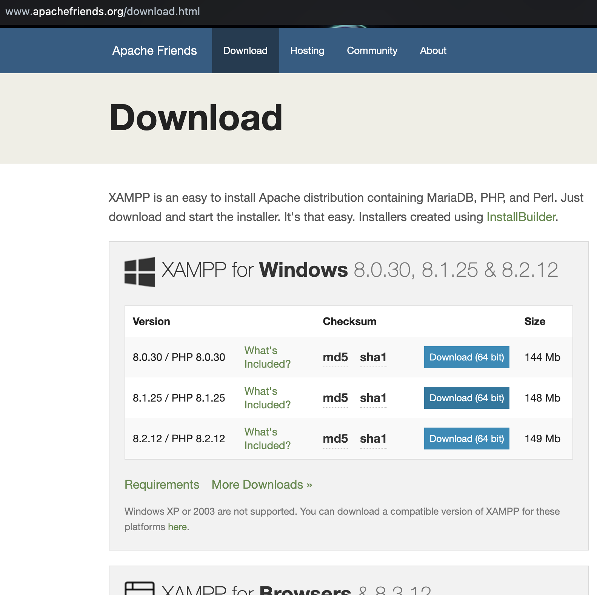
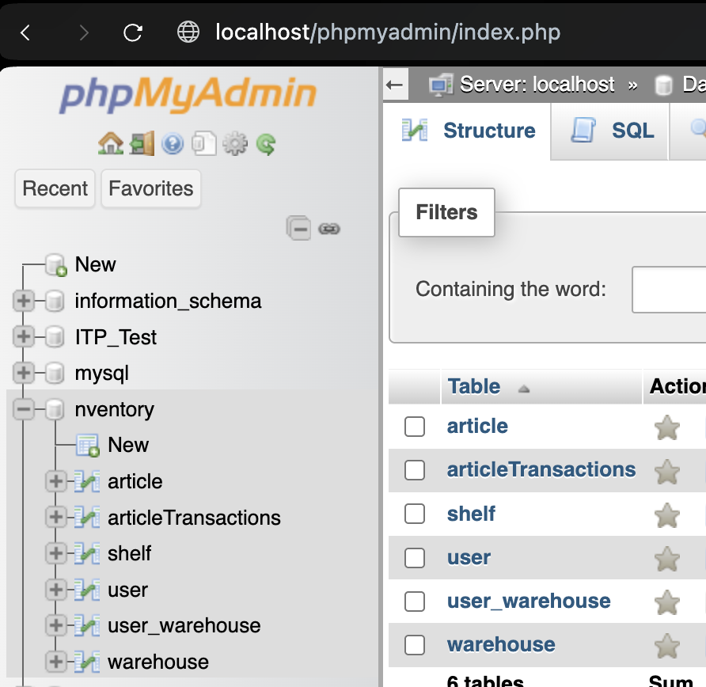
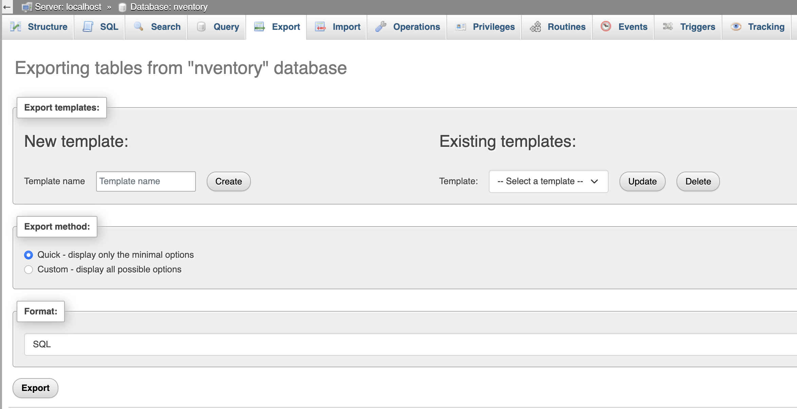
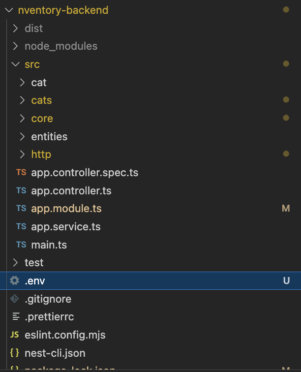
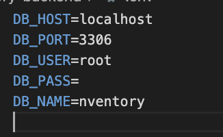
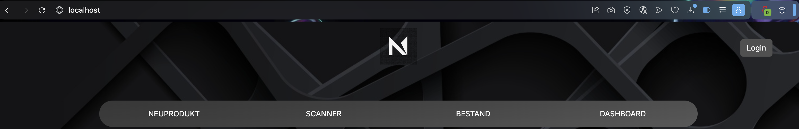

# Deployment Manual for Nventory Project

<p align="center"></p>

## Prerequisites
- **XAMPP 8.2.4-0** (Download from [apachefriends.org](https://www.apachefriends.org/download.html))
- **Node.js** (Recommended: v18+)
- **Git** (for cloning the repository)

---

## 1. Install XAMPP
- Download and install XAMPP 8.2.4-0 for your operating system.
- Start XAMPP and ensure Apache and MySQL services are running.

<p align="center"></p>

## 2. Clone or Copy the Project
- **Clone the repository using Git:**
  ```sh
  git clone <your-repository-url>
  ```
  ```sh
  unarchive the project from the .zip
  ```
- Or place the entire project folder into the `htdocs` directory of your XAMPP installation:
  - **Windows:** `C:\xampp\htdocs\ITP`
  - **macOS:** `/Applications/XAMPP/htdocs/ITP`

## 3. Install Backend Dependencies
- Open a terminal/command prompt and navigate to the backend directory:
  ```sh
  cd <project-root>/nventory-backend
  npm install
  ```
- This installs the neccessary dependencies to run the nestJS server

## 4. Import the Database
- Open [phpMyAdmin](http://localhost/phpmyadmin) in your browser.

<p align="center"></p>

- Create a new database (e.g., `nventory`).
- Import the SQL dump file: `DATABASE/nventory_dump.sql`.

<p align="center"></p>


## 5. Configure Backend Database Connection
- Edit `nventory-backend/.env` if needed to match your local MySQL credentials (user, password, database name).

<p align="center"></p>
<p align="center"></p>

## 6. Start the Backend Server
- In the backend directory, run:
  ```sh
  npm run start
  ```
- This starts the backend server and gets a connection to the database

## 7. Access the Application
- Open your browser and go to:
  - **Windows:** `http://localhost/`
  - **macOS:** `http://localhost/`
<p align="center"></p>

---
